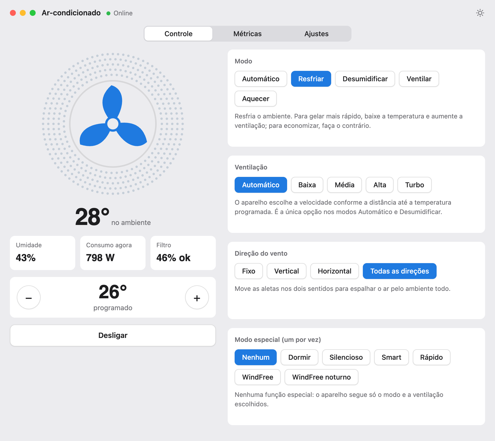
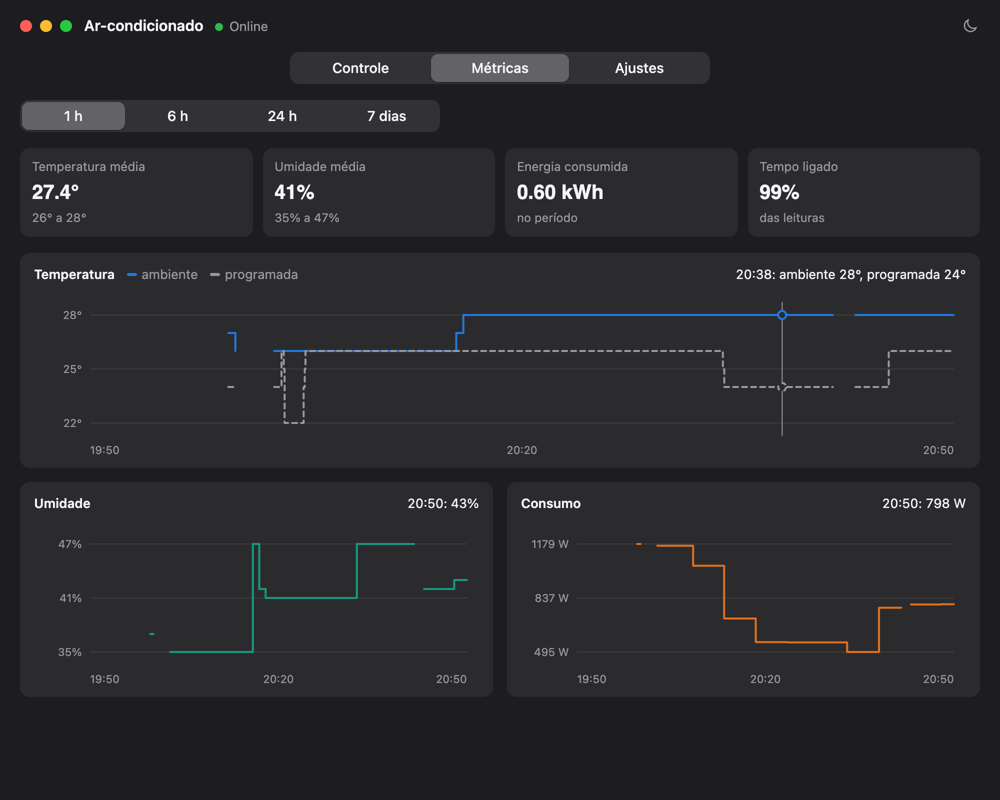
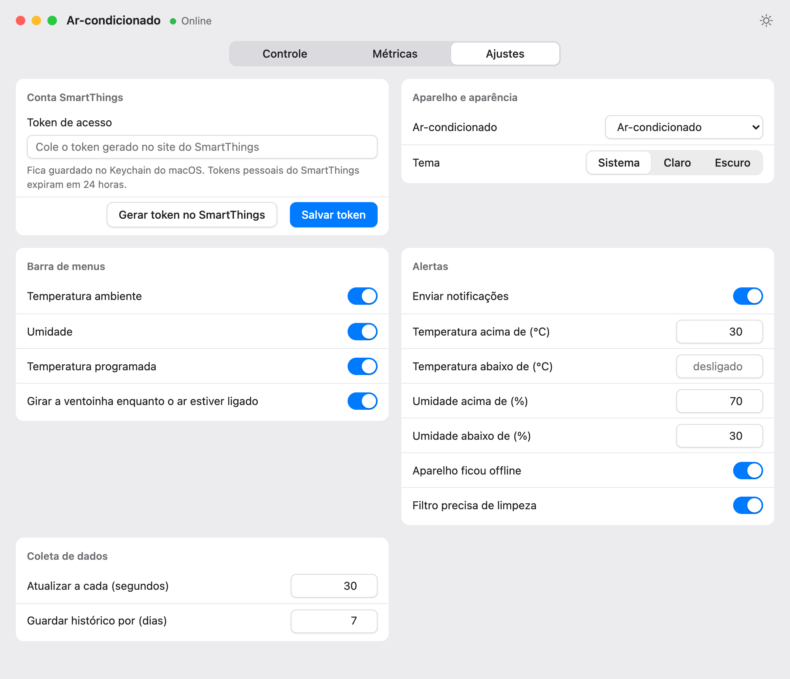
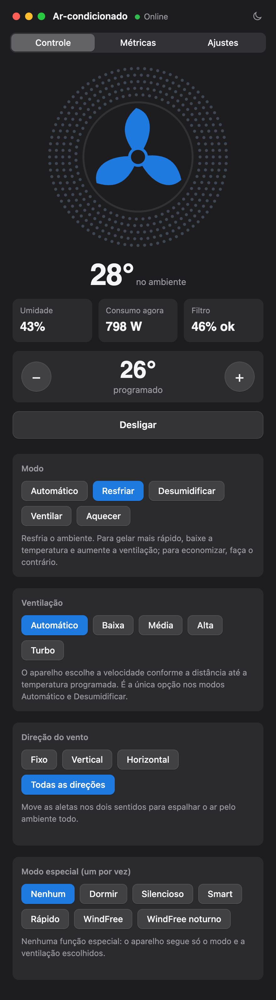
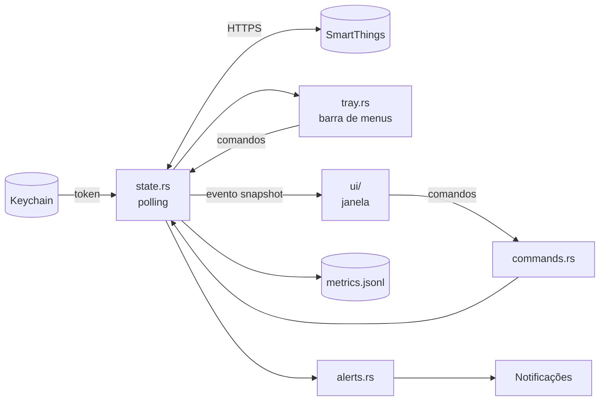

<p align="center"></p>

<h1 align="center">WindFree</h1>

<p align="center">Controle o ar-condicionado Samsung WindFree pela barra de menus do macOS.</p>

<p align="center"></p>



## O que faz

- **Barra de menus.** Uma ventoinha que gira enquanto o ar está ligado, mais rápido conforme a ventilação, e ao lado a temperatura ambiente, a umidade e a temperatura programada. Você escolhe o que aparece.
- **Menu da barra.** Ligar e desligar, ±1 °C, modo, ventilação, direção do vento e modo especial (WindFree, good'sleep, Rápido…) sem abrir janela.
- **Painel.** Controle completo, com a explicação de cada modo tirada dos manuais da Samsung, consumo em watts e uso do filtro.
- **Métricas.** Histórico de temperatura, umidade e consumo em 1 h, 6 h, 24 h ou 7 dias, com média, faixa, energia consumida e tempo ligado. Passe o mouse no gráfico para ler um ponto.
- **Alertas.** Notificação de ambiente quente ou frio, umidade alta ou baixa, aparelho offline, filtro sujo e token expirado.
- **Aparência.** Tema claro, escuro ou do sistema, layout que se adapta ao tamanho da janela e zoom com ⌘+ / ⌘−.

| Métricas, tema escuro | Ajustes |
| --- | --- |
|  |  |

<details>
<summary>Janela estreita, tema escuro</summary>
<p></p>
</details>

## Como funciona

O ar-condicionado não expõe nenhuma API na rede local; ele só conversa com a nuvem da Samsung. O app usa a [API REST do SmartThings](https://developer.smartthings.com/docs/api/public) com um token pessoal.



1. A cada intervalo (30 s por padrão) o app lê `/devices/{id}/health` e `/devices/{id}/components/main/status` e monta um snapshot do aparelho.
2. Cada snapshot atualiza o título e o menu da barra, é enviado para a janela, vira uma linha em `metrics.jsonl` e passa pelos alertas. Cada alerta dispara uma vez ao cruzar o limite e só volta a valer depois que a leitura recua uma margem (0,5 °C ou 3 %).
3. Um comando (pela janela ou pelo menu) vai para `POST /devices/{id}/commands`. A interface já mostra o novo estado e o app relê o aparelho 2,5 s depois para confirmar.
4. O ícone da ventoinha é desenhado em Rust na inicialização (24 quadros, sem arquivos de imagem) e enviado ao macOS como imagem *template*, por isso acompanha a cor da barra.
5. O tema é aplicado na janela nativa; o WebView, os botões da janela e os campos seguem o mesmo tema por `prefers-color-scheme`.

### Estrutura

```
core/src/
  lib.rs          inicialização, janela e tema
  smartthings.rs  cliente REST, leitura do status e comandos
  state.rs        estado compartilhado, polling e envio de comandos
  tray.rs         título, menu e ícone animado da barra
  metrics.rs      histórico em JSON lines e agregação para os gráficos
  alerts.rs       alertas com histerese
  settings.rs     configurações e token no Keychain
  commands.rs     comandos chamados pela interface
  labels.rs       nomes em português dos modos
  error.rs        tipo de erro
ui/               HTML, CSS e JS puros, sem framework nem bundler
docs/screenshots/ imagens deste README
```

### Onde ficam os dados

| O quê | Onde |
| --- | --- |
| Token do SmartThings | Keychain, serviço `dev.mpgxc.windfree`, conta `smartthings-token` |
| Configurações | `~/Library/Application Support/dev.mpgxc.windfree/settings.json` |
| Histórico | `~/Library/Application Support/dev.mpgxc.windfree/metrics.jsonl`, uma leitura por linha. Leituras mais antigas que o período configurado são apagadas ao abrir o app. |

## Requisitos

- macOS 11 ou mais recente
- [Rust](https://rustup.rs) estável
- Node.js 18 ou mais recente e [pnpm](https://pnpm.io/installation) (só para o CLI do Tauri)
- Xcode Command Line Tools: `xcode-select --install`
- O ar-condicionado cadastrado no app SmartThings

## Primeiro uso

1. Gere um token em [account.smartthings.com/tokens](https://account.smartthings.com/tokens) com as permissões:
   - **Devices:** List all devices, See all devices, Control all devices
   - **Locations:** See all locations
2. Abra o WindFree. Na primeira vez a janela abre em **Ajustes**: cole o token e clique em **Salvar token**. Se a conta tiver um único ar-condicionado, ele já fica selecionado.
3. Fechar a janela só a esconde; o app continua na barra. Para sair, use **Sair do WindFree** no menu da barra.

Tokens pessoais do SmartThings expiram em 24 horas. Quando isso acontece o app avisa por notificação; gere outro e salve em Ajustes.

## Desenvolvimento

```bash
pnpm install
pnpm dev                                # compila em modo debug e abre o app
cd core && cargo test                   # testes unitários
cd core && cargo clippy --all-targets
```

A interface em `ui/` é embutida no binário. Depois de editar HTML, CSS ou JS, reinicie o `pnpm dev`.

Cada recompilação gera um binário novo, e o macOS pode pedir permissão para o app ler o token no Keychain. Escolha **Permitir sempre**.

## Build

```bash
pnpm build
```

Gera, em cerca de 1 min 30 s numa máquina Apple Silicon:

| Arquivo | Tamanho |
| --- | --- |
| `core/target/release/bundle/macos/WindFree.app` | 14 MB |
| `core/target/release/bundle/dmg/WindFree_0.1.0_aarch64.dmg` | 4,4 MB |

Para instalar, arraste o `WindFree.app` para `/Applications`. Para abrir junto com o Mac, adicione o app em **Ajustes do Sistema → Geral → Itens de Início**.

- O app não é assinado. Se o `.dmg` for copiado para outro Mac, o Gatekeeper bloqueia a primeira abertura; abra com botão direito → **Abrir**.
- Sem sessão gráfica (CI, SSH), use `CI=true pnpm build`. Isso pula a etapa que usa o Finder para arrumar a janela do DMG.

## Limitações

- Tudo passa pela nuvem do SmartThings; sem internet não há controle nem leituras.
- O token pessoal dura 24 horas. Para uso contínuo, o caminho é registrar um app OAuth no SmartThings, o que ainda não foi feito.
- A nuvem entrega leituras em degraus: temperatura em graus inteiros e consumo atualizado a cada 5 minutos.
- Alguns modelos aceitam pela API, mas ignoram, certos modos especiais, como o Silencioso ([relato na comunidade SmartThings](https://community.smartthings.com/t/rest-api-does-not-accept-some-commands-options/258705)).
- O histórico só é gravado enquanto o app está aberto; os períodos sem dados aparecem como falhas no gráfico.

## Referências

- [API REST do SmartThings](https://developer.smartthings.com/docs/api/public)
- Manuais Samsung WindFree: [2.0e (DB68-11414A)](https://s3.amazonaws.com/samsung-files/Tech_Files/RAC/WindFree+2.0e+AR+BSFCMWK/User+Manuals/AR+BSFCMWK_User+Manual_DB68-11414A-00_ENGLISH.pdf) e [3.0 (DB68-12013A)](https://d3nq8rpsskbdh6.cloudfront.net/userfiles/product/documents/4a/a9/8f/windfree%2b3.0_ar%2bcsda%2bb%28f%29%2bwkncv_user%2bmanual_db68-12013a-00_english%2520%281%29.pdf)
- [Integração SmartThings do Home Assistant](https://github.com/home-assistant/core/blob/dev/homeassistant/components/smartthings/climate.py), usada para relacionar os nomes da API às funções dos manuais
- [Tauri 2](https://v2.tauri.app/)
